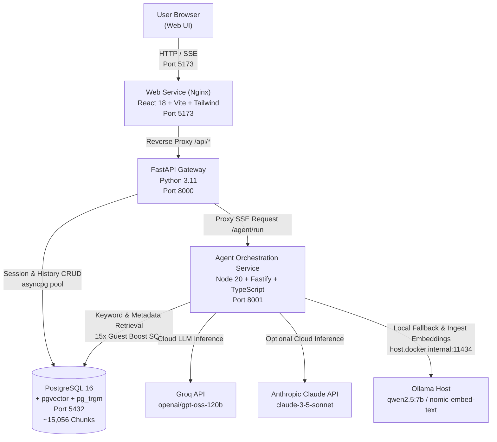
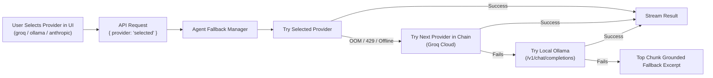

# Architecture Document — Lenny Growth Assistant

## 1. System Overview & Component Topology

Lenny Growth Assistant is built as a production-grade, two-service microservice architecture containerized with Docker Compose. It leverages PostgreSQL 16 with `pgvector` and `pg_trgm` as a single authoritative store for both relational session persistence and semantic/full-text search over podcast transcripts.



### Docker Compose Service Breakdown

| Service | Context / Base Image | Port Mapping | Responsibilities |
|---|---|---|---|
| `db` | `pgvector/pgvector:pg16` | `5432:5432` | Stores sessions, messages, and ~15,056 indexed dialogue chunks with pgvector embeddings & trigram indices |
| `api` | `./api` (Python 3.11-slim) | `8000:8000` | Gateway, session lifecycle, message storage, backend HTML sanitization (`nh3`), live provider health probes, SSE proxying |
| `agent` | `./agent` (Node 20-alpine) | `8001:8001` | Intent routing (`question` vs `essay`), hybrid retrieval with guest boosting, prompt assembly, quote card generation, multi-provider fallback |
| `web` | `./web` (Node 20 build → Nginx alpine) | `5173:80` | React UI, provider switcher dropdown, Verified Episode Quote Cards, dynamic follow-up chips, Growth Radar shortcuts, sandboxed artifact viewer |
| `ingest` | `./ingest` (Node 20-alpine) | — | One-shot transcript parser, sliding window chunker, YouTube timestamp linker, nomic-embed-text vectorizer |

---

## 2. Technology Stack & Architectural Decisions

| Decision / Component | Choice | Justification & Trade-off |
|---|---|---|
| **API Gateway** | **FastAPI (Python 3.11)** | Asynchronous native routing, standard Pydantic schema validation, robust `asyncpg` connection pooling, and straightforward SSE streaming proxy support. |
| **Agent Orchestrator** | **Fastify + Node 20 (TypeScript)** | Strong typing for multi-agent/tool composition, zero-overhead event streaming, and native async fetch handlers for cloud & local LLM APIs. |
| **Database & Vector Store** | **PostgreSQL 16 + pgvector** | Eliminates separate vector DB infrastructure overhead; enables unified transactional storage for conversation sessions and hybrid semantic/keyword search over transcripts. |
| **LLM Provider Strategy** | **Multi-tier with Dynamic Toggle & Fallback** | Primary: Groq (`openai/gpt-oss-120b`) for ultra-low latency (<2s). Fallback: Local Ollama (`qwen2.5:7b` via OpenAI-compatible `/v1` endpoint). Optional: Anthropic Claude. Dynamic UI selection with real-time health probing. |
| **Frontend Architecture** | **React 18 + Vite + Tailwind CSS** | Clean monochrome theme (`#F5F5F5` accents), fast client-side state management, responsive three-column workstation layout. |
| **Security Layer** | **Defense-in-Depth Sanitization** | `DOMPurify` on client Markdown, backend `nh3` HTML sanitizer, and strictly sandboxed `iframe` (`sandbox="allow-scripts"`, without `allow-same-origin`) with restrictive Content Security Policy (CSP). |

---

## 3. Database Schema

The database schema is managed in PostgreSQL with `vector` and `pg_trgm` extensions enabled:

```sql
-- Conversations and Sessions
CREATE TABLE sessions (
    id          UUID PRIMARY KEY DEFAULT gen_random_uuid(),
    title       TEXT,
    created_at  TIMESTAMPTZ DEFAULT now(),
    updated_at  TIMESTAMPTZ DEFAULT now()
);

-- Conversation Turn Messages
CREATE TABLE messages (
    id          UUID PRIMARY KEY DEFAULT gen_random_uuid(),
    session_id  UUID REFERENCES sessions(id) ON DELETE CASCADE,
    role        TEXT NOT NULL CHECK (role IN ('user', 'assistant', 'system')),
    content     TEXT NOT NULL,
    metadata    JSONB DEFAULT '{}',
    created_at  TIMESTAMPTZ DEFAULT now()
);

-- Versioned Artifacts (Ship 30 atomic essays & frameworks)
CREATE TABLE artifacts (
    id          UUID PRIMARY KEY DEFAULT gen_random_uuid(),
    message_id  UUID REFERENCES messages(id) ON DELETE SET NULL,
    type        TEXT NOT NULL CHECK (type IN ('markdown', 'html')),
    content     TEXT NOT NULL,
    version     INTEGER NOT NULL DEFAULT 1,
    created_at  TIMESTAMPTZ DEFAULT now()
);

-- Transcript Chunks with Deep Links & Metadata
CREATE TABLE chunks (
    id          SERIAL PRIMARY KEY,
    episode     TEXT NOT NULL,
    guest       TEXT,
    title       TEXT,
    position    INTEGER NOT NULL,
    text        TEXT NOT NULL,
    url         TEXT,                 -- Verified YouTube deep link with timestamp
    embedding   vector(768),          -- nomic-embed-text (768-dim)
    created_at  TIMESTAMPTZ DEFAULT now()
);

CREATE INDEX idx_chunks_episode ON chunks(episode);
CREATE INDEX idx_chunks_guest ON chunks(guest);
CREATE INDEX idx_chunks_text_trgm ON chunks USING gin (text gin_trgm_ops);
```

---

## 4. API Gateway Endpoints (`api:8000`)

| Method | Endpoint | Description |
|---|---|---|
| `GET` | `/health` | Shallow health check for Docker container orchestrator. |
| `GET` | `/health/deep` | Deep health diagnostics verifying DB connection pool, Agent reachability, Ollama socket, and chunk counts. |
| `GET` | `/config` | Returns active runtime configuration and live health statuses of all providers (`groq`, `ollama`, `anthropic`). |
| `GET` | `/sessions` | Lists all chat sessions sorted by recency (`created_at DESC`). |
| `POST` | `/sessions` | Initializes a new chat session container. |
| `GET` | `/sessions/{id}` | Retrieves full message history and metadata for a given session. |
| `POST` | `/sessions/{id}/messages` | Accepts user prompt and provider choice; persists message, proxies SSE stream from Agent, and returns chunk citations. |
| `GET` | `/artifacts/{id}` | Fetches artifact content with backend-sanitized HTML/Markdown. |

---

## 5. Ingestion & Retrieval Pipeline

### Ingestion Flow (`ingest/src/ingest.ts`)
1. **Frontmatter Parsing**: Extracts guest names, official YouTube URLs, and publishing metadata from episode markdown files.
2. **Chunking Engine**: Sliding window chunking (~500 words per chunk with 80-word overlap) preserving speaker transitions.
3. **Deep Link Calculation**: Calculates YouTube timestamp offsets (`&t=X` seconds) based on chunk ordinal position.
4. **Embedding Generation**: Vectorized via Ollama's `nomic-embed-text` (768-dimension embeddings).
5. **Idempotent Upsert**: Batched insertion into PostgreSQL `chunks` table.

### Retrieval & Grounding Flow (`agent/src/retrieval.ts`)
1. **Query Parsing & Guest Extraction**: Strips conversational stop words and detects referenced guests or topics.
2. **Guest-Boosted Hybrid Retrieval**:
   - Matches against `guest`, `episode`, and full chunk dialogue.
   - Applies a **15x scoring boost** for exact guest name matches.
   - Suppresses raw metadata frontmatter chunks (`position = 0`).
3. **Confidence Filtering**: If top chunk similarity fails to reach relevance thresholds, triggers verbatim fallback:
   `"The transcripts don't support an answer."`
4. **Verbatim Quote & Deep Link Injection**:
   - Generates a **Verified Episode Quote Card** with the exact quote excerpt, guest name, and playable YouTube timestamp URL.
   - Contextual follow-up suggestions dynamically synthesized based on the primary guest.

---

## 6. Provider Toggle & Fallback Chain



- **OpenAI-Compatible Standard**: Both Groq and local Ollama are accessed via standard OpenAI `/v1/chat/completions` specifications.
- **Provider Status Indicator**: Real-time probe on `/config` renders visual status dots (`● Online` vs `○ Offline`) in the header dropdown.

---

## 7. Security Architecture

1. **Sandboxed Artifact Viewer**: Rendered inside an `<iframe>` configured strictly with `sandbox="allow-scripts"` (omits `allow-same-origin` to isolate DOM access and session storage).
2. **Content Security Policy (CSP)**: Injected directly into the iframe `srcdoc`:
   ```html
   <meta http-equiv="Content-Security-Policy" content="default-src 'none'; style-src 'unsafe-inline'; script-src 'unsafe-inline';">
   ```
3. **Dual Sanitization**: Client uses `DOMPurify` for rendering raw Markdown; API uses `nh3` for server-side HTML cleansing before storage and dispatch.
4. **Credential Isolation**: Zero hardcoded secrets; credentials configured via `.env` with `.env.example` validation checks in CI.

---

## 8. Resilience & Operational Troubleshooting

| Failure Scenario | Built-in Mitigation |
|---|---|
| **Ollama Out of Memory (OOM)** | Agent catches `CUDA_Host` or `CPU_REPACK` buffer allocation errors, automatically logs structured diagnostic, and routes inference to Groq cloud provider. |
| **Missing API Keys** | API `/config` marks provider offline; UI automatically disables selection and defaults to first operational provider. |
| **Irrelevant / Out-of-Corpus Queries** | Grounding threshold prevents hallucinated responses and returns strict refusal text. |
| **Database Network Partitions** | `asyncpg` connection pool with automatic health checks and exponential retry on transient connection drops. |
