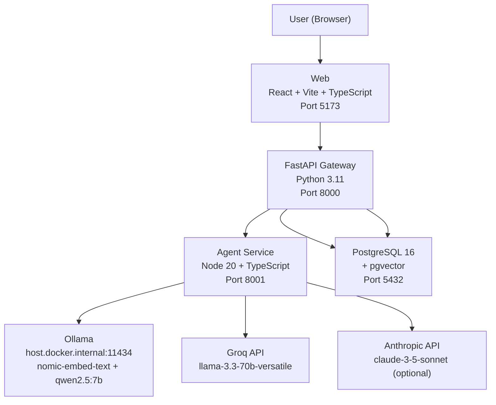

# Architecture Document — Lenny Growth Assistant

> [!NOTE]
> Sections marked **[placeholder]** are accurate for the Phase 1 scaffold. They will be filled in during the phase indicated.

## 1. Component Diagram



### Docker Compose Services

| Service | Image/Build | Port | Role |
|---|---|---|---|
| `db` | `pgvector/pgvector:pg16` | 5432 | PostgreSQL + pgvector + pg_trgm |
| `api` | `./api` (Python 3.11-slim) | 8000 | FastAPI gateway, session management, SSE proxy |
| `agent` | `./agent` (Node 20-alpine) | 8001 | LLM orchestration, retrieval, skill routing |
| `web` | `./web` (Node 20 + nginx) | 5173→80 | React frontend served by nginx |
| `ingest` | `./ingest` (Node 20-alpine) | — | One-shot ingestion; profile: `ingest` |

---

## 2. Stack Justification

| Choice | Justification |
|---|---|
| **FastAPI (Python 3.11)** | Python ecosystem for LLM tooling; async-native; Pydantic validation; SSE support |
| **TypeScript Agent (Node 20)** | Type-safe skill composition; fast startup; excellent async I/O for concurrent LLM calls |
| **PostgreSQL + pgvector** | Semantic search without a separate vector DB; BM25 via `tsvector`; ACID guarantees |
| **React + Vite** | Fast dev server; small bundle; excellent TypeScript support |
| **Tailwind CSS** | Rapid UI development; consistent design tokens; no runtime CSS |
| **Ollama (local)** | Free local inference; mandatory for demo; nomic-embed-text for embeddings |
| **Groq (cloud)** | Free tier; fast inference (low latency); OpenAI-compatible API |
| **Anthropic (optional)** | High-quality reasoning for complex essays; paid |

---

## 3. Database Schema [placeholder — Phase 2]

> Full migrations created in Phase 2. Below is the planned schema.

```sql
-- Sessions: top-level conversation containers
CREATE TABLE sessions (
    id          UUID PRIMARY KEY DEFAULT gen_random_uuid(),
    title       TEXT,
    created_at  TIMESTAMPTZ DEFAULT now(),
    updated_at  TIMESTAMPTZ DEFAULT now()
);

-- Messages: individual turns in a session
CREATE TABLE messages (
    id          UUID PRIMARY KEY DEFAULT gen_random_uuid(),
    session_id  UUID REFERENCES sessions(id) ON DELETE CASCADE,
    role        TEXT NOT NULL CHECK (role IN ('user', 'assistant', 'system')),
    content     TEXT NOT NULL,
    metadata    JSONB DEFAULT '{}',
    created_at  TIMESTAMPTZ DEFAULT now()
);

-- Artifacts: versioned Markdown/HTML outputs
CREATE TABLE artifacts (
    id          UUID PRIMARY KEY DEFAULT gen_random_uuid(),
    message_id  UUID REFERENCES messages(id),
    type        TEXT NOT NULL CHECK (type IN ('markdown', 'html')),
    content     TEXT NOT NULL,
    version     INTEGER NOT NULL DEFAULT 1,
    created_at  TIMESTAMPTZ DEFAULT now()
);

-- Chunks: transcript segments with embeddings
CREATE TABLE chunks (
    id              UUID PRIMARY KEY DEFAULT gen_random_uuid(),
    episode_id      TEXT NOT NULL,
    episode_title   TEXT,
    guest           TEXT,
    published_date  DATE,
    content         TEXT NOT NULL,
    content_hash    TEXT NOT NULL UNIQUE,  -- idempotent upsert
    embedding       vector(768),           -- nomic-embed-text dims
    ts_content      tsvector,              -- BM25 via tsvector
    created_at      TIMESTAMPTZ DEFAULT now()
);

-- Retrieval logs: for evaluation and debugging
CREATE TABLE retrieval_logs (
    id              UUID PRIMARY KEY DEFAULT gen_random_uuid(),
    message_id      UUID REFERENCES messages(id),
    query           TEXT,
    chunks_retrieved JSONB,
    scores          JSONB,
    latency_ms      INTEGER,
    created_at      TIMESTAMPTZ DEFAULT now()
);
```

---

## 4. API Endpoints [placeholder — Phases 3-6]

> Full endpoint implementation in Phases 3-6. Below is the planned surface.

| Method | Path | Phase | Description |
|---|---|---|---|
| GET | `/health` | 1 ✅ | Service health (scaffold only) |
| GET | `/config` | 1 ✅ | Provider config (scaffold only) |
| POST | `/sessions` | 3 | Create new chat session |
| GET | `/sessions` | 3 | List sessions |
| GET | `/sessions/{id}` | 3 | Get session with messages |
| POST | `/sessions/{id}/messages` | 3 | Send message (streams via SSE) |
| GET | `/artifacts/{id}` | 5 | Get artifact by ID |
| GET | `/artifacts/{id}/versions` | 5 | List artifact versions |
| GET | `/health/deep` | 6 | Deep health (DB, agent, Ollama, index) |

---

## 5. Ingestion Flow [placeholder — Phase 2]

```
1. Clone/pull transcript repository (TRANSCRIPT_REPO_URL)
2. Parse episodes: extract title, guest, date, speaker turns
3. Chunk: ~500 tokens per chunk, ~80 token overlap (sliding window)
4. Embed: POST to Ollama nomic-embed-text
5. Upsert to PostgreSQL chunks table (content_hash for idempotency)
6. Update tsvector column for BM25
7. Refresh mode: re-ingest only files changed since last run
```

---

## 6. Retrieval Flow [placeholder — Phase 3]

```
1. Query rewrite: LLM rewrites user question for retrieval
2. BM25 retrieval: tsvector full-text search (top-20)
3. pgvector retrieval: cosine similarity on embedding (top-20)
4. RRF fusion: Reciprocal Rank Fusion combines both lists
5. Top-k selection: top-5 chunks by RRF score
6. Threshold check: if max score < threshold → refuse (out-of-scope)
7. LLM answer: prompt = system + chunks + user question
8. Citation injection: [1][2] markers map to chunk IDs
```

---

## 7. Provider Toggle

Configured via `LLM_PROVIDER` environment variable.

| Provider | API | Model | Use Case |
|---|---|---|---|
| `groq` | OpenAI-compatible | `llama-3.3-70b-versatile` | Default cloud; fast; free tier |
| `ollama` | OpenAI-compatible | `qwen2.5:7b` | Local; mandatory for demo |
| `anthropic` | Anthropic SDK | `claude-3-5-sonnet-*` | Optional; best essay quality |

**Fallback chain:** `LLM_FALLBACK=ollama` (comma-separated, in priority order)

**Provider interface (Phase 3):**
```typescript
interface LLMProvider {
  complete(prompt: string, options: CompletionOptions): Promise<CompletionResult>;
  stream(prompt: string, options: CompletionOptions): AsyncIterable<string>;
}
```

---

## 8. Security Model [placeholder — Phase 5]

| Threat | Mitigation |
|---|---|
| XSS via artifact rendering | Iframe `sandbox="allow-scripts"` (no `allow-same-origin`) |
| XSS via Markdown | DOMPurify before DOM injection |
| Unsafe CSS in artifacts | CSP in iframe `srcdoc`: `default-src 'none'; style-src 'unsafe-inline'` |
| Prompt injection | Instruction hierarchy: system > retrieved chunks > user message |
| API key exposure | `.env` in `.gitignore`; CI checks `.env.example` has empty secrets |
| SQL injection | Parameterized queries (asyncpg/psycopg); no string interpolation |

---

## 9. Deployment

```yaml
# docker compose up -d
# Ollama must be running on host (not in Docker)
# ollama pull nomic-embed-text && ollama pull qwen2.5:7b
```

**Ollama on host:** Services access Ollama via `host.docker.internal:11434`. This is the Docker Desktop default on macOS/Windows. On Linux, use `--add-host=host.docker.internal:host-gateway`.

**One-shot ingest:**
```bash
docker compose --profile ingest run --rm ingest
```

---

## 10. Trade-offs

| Decision | Trade-off |
|---|---|
| **Two-service architecture (FastAPI + TypeScript agent)** | Adds inter-service SSE proxying complexity, but enables Python LLM ecosystem (FastAPI, asyncpg) + TypeScript type safety for skill composition. Measurements pending. |
| **pgvector over dedicated vector DB** | Simpler operations (one DB); slightly lower throughput at very large scale; acceptable for podcast-scale corpus (~10k chunks) |
| **SSE over WebSocket** | Simpler server-side (no upgrade handshake); no bidirectional need; reconnection handled by browser EventSource |
| **Ollama mandatory** | Embeddings always use Ollama (nomic-embed-text); this simplifies the embedding pipeline but requires Ollama to be running even if using Groq/Anthropic for inference |
| **npm workspaces (monorepo)** | Shared devDependencies; single `npm install`; slight complexity in Docker builds (each service has its own package.json) |


## Observability & Health
- **Logging:** Structured JSON logs via structlog (Python) and pino (Node).
- **Deep Health:** /health endpoint checks DB connectivity, Agent availability, Ollama responsiveness, Index size (mocked), and API key presence boolean.
- **Resilience:** Graceful failures with retry hints for 502/503.
